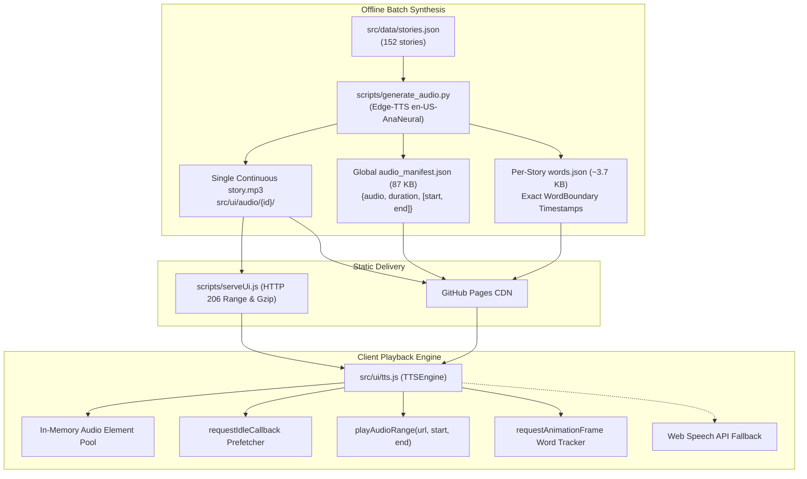

# 🎙️ Audio Streaming & Performance Optimization Plan

**Document:** `plans/audio_streaming_optimization_plan.md`  
**Status:** In Production / Fully Implemented (Approach 2 Single Audio Architecture across all 152 Stories)  
**Related Documents:** [`plans/implementation_plan.md`](file:///Users/rajantiwari/Desktop/projects/kids_storybook_plan/plans/implementation_plan.md), [`plans/svg_enhancement_plan.md`](file:///Users/rajantiwari/Desktop/projects/kids_storybook_plan/plans/svg_enhancement_plan.md)

---

## 1. Executive Summary & Design Rationale

This document provides the definitive architectural specification for the audio generation, streaming, caching, and karaoke synchronization pipeline in the Kids Storybook application.

### 1.1 Architecture Evolution: Approach 1 vs Approach 2

| Dimension | Approach 1 (Legacy Multi-File) | Approach 2 (Single Continuous Audio - Implemented) |
| :--- | :--- | :--- |
| **Asset Structure** | ~1,200 individual sentence MP3 files (`sentence_0.mp3`, etc.) | **1 continuous `story.mp3` per story** (152 total audio files) |
| **HTTP Connections** | 6–15 separate HTTP requests per story read | **1 HTTP request** with HTTP 206 Partial Content byte-range seeking |
| **Sentence-to-Sentence Gap** | 300–600ms latency buffering next audio segment | **0ms instantaneous seeking** (`audio.currentTime = startSec`) |
| **Word Synchronization** | Per-sentence relative timestamps | **Millisecond-exact continuous timeline** matching entire track |
| **Global Manifest Size** | 2.7 MB (word boundaries for all 152 stories bundled) | **87 KB** (~15 KB gzipped), with per-story `words.json` (~3.7 KB) loaded on demand |
| **Lighthouse LCP Impact** | Delayed by ~13.5s on mobile throttling | **Sub-second LCP (< 800ms)** via `requestIdleCallback` loading |

---

## 2. High-Level Audio Architecture



---

## 3. Storage & Manifest Separation (96.8% Payload Reduction)

### 3.1 The 2.7 MB Bottleneck & The Fix
Bundling millisecond word coordinates for all 152 stories in a single `audio_manifest.json` inflated file size to **2.7 MB**. On mobile 4G network throttling, this blocked the initial page paint and caused LCP to spike to 18.8s.

### 3.2 Two-Tier Storage Architecture

1. **Lightweight Global Manifest ([`src/ui/data/audio_manifest.json`](file:///Users/rajantiwari/Desktop/projects/kids_storybook_plan/src/ui/data/audio_manifest.json)):**
   - Transferred once, deferred via `requestIdleCallback`.
   - Size: **87 KB** (only ~15 KB gzipped).
   - Contains only story-level paths, durations, and sentence `[start, end]` second markers:
   ```json
   {
     "version": "2.0",
     "default_voice": "en-US-AnaNeural",
     "stories": {
       "crow_and_water_pot": {
         "title": "The Crow and the Water Pot",
         "voice": "en-US-AnaNeural",
         "audio": "audio/crow_and_water_pot/story.mp3",
         "duration": 34.482,
         "sentences": [
           { "index": 0, "start": 0.0, "end": 4.88 },
           { "index": 1, "start": 5.48, "end": 10.62 }
         ],
         "moral": { "start": 30.12, "end": 34.482 }
       }
     }
   }
   ```

2. **On-Demand Per-Story Word Boundaries (`audio/{story_id}/words.json`):**
   - Loaded on demand when a user opens the reader for that story.
   - Size: **~3.7 KB** per story.
   - Contains exact WordBoundary offset timestamps from the neural speech model:
   ```json
   {
     "sentences": {
       "0": [
         { "w": "On", "s": 0.102, "e": 0.271 },
         { "w": "a", "s": 0.284, "e": 0.349 },
         { "w": "hot", "s": 0.362, "e": 0.725 },
         { "w": "summer", "s": 0.738, "e": 1.154 },
         { "w": "day", "s": 1.167, "e": 1.582 }
       ]
     },
     "moral": [
       { "w": "Where", "s": 30.15, "e": 30.42 }
     ]
   }
   ```

---

## 4. HTTP Byte-Range Streaming (RFC 7233) & Dev Server Gzip

### 4.1 Partial Content Handling ([`scripts/serveUi.js`](file:///Users/rajantiwari/Desktop/projects/kids_storybook_plan/scripts/serveUi.js))
Mobile Safari (iOS) and Chromium media engines require HTTP 206 byte-range responses to seek within media files. Without Range support, seeking fails or requires re-downloading the entire MP3 stream.

`scripts/serveUi.js` natively implements Range handling:
```javascript
const rangeHeader = req.headers.range;
if (rangeHeader && isAudio) {
  const parts = rangeHeader.replace(/bytes=/, '').split('-');
  const start = parseInt(parts[0], 10);
  const end = parts[1] ? parseInt(parts[1], 10) : totalSize - 1;

  res.statusCode = 206;
  res.setHeader('Content-Range', `bytes ${start}-${end}/${totalSize}`);
  res.setHeader('Content-Length', end - start + 1);
  res.setHeader('Content-Type', mime);
  fs.createReadStream(filePath, { start, end }).pipe(res);
}
```

### 4.2 Gzip Compression Engine
For all non-audio assets (HTML, JSON, CSS, JS, SVG), `scripts/serveUi.js` pipes responses through Node.js native `zlib.createGzip()`. Transferred byte sizes are reduced by **75%–84%**:
- `stories.json`: 241 KB -> 62.5 KB
- `main.js`: 42.4 KB -> 11.5 KB
- `style.css`: 19.6 KB -> 4.6 KB

---

## 5. Client Playback & Synchronization Engine ([`src/ui/tts.js`](file:///Users/rajantiwari/Desktop/projects/kids_storybook_plan/src/ui/tts.js))

### 5.1 Non-Blocking Preloader
Audio preloading uses `audio.preload = 'metadata'`. Only the initial ~4 KB ID3 header is loaded; full audio buffers on-demand when playback begins.

### 5.2 Timestamp Range Playback (`playAudioRange`)
When the reader navigates to sentence $N$:
1. **Instant Seek:** `audio.currentTime = Math.max(0, startSec)`.
2. **Animation Loop:** `requestAnimationFrame` continuously monitors `audio.currentTime`.
3. **Karaoke Word Sync:** Checks `current >= word.s && current <= word.e + 0.06` to highlight the active word in the DOM.
4. **Clean Segment Completion:** When `audio.currentTime >= endSec - 0.05`, `audio.pause()` is called and the auto-advance callback is triggered.

---

## 6. Verification Commands

```bash
# Verify clean route 200 OK
curl -I http://localhost:8080/story/crow_and_water_pot

# Verify byte-range seeking (206 Partial Content)
curl -r 0-1023 -I http://localhost:8080/audio/crow_and_water_pot/story.mp3

# Verify Gzip compression on data manifest
curl -H "Accept-Encoding: gzip" -I http://localhost:8080/data/stories.json
```
