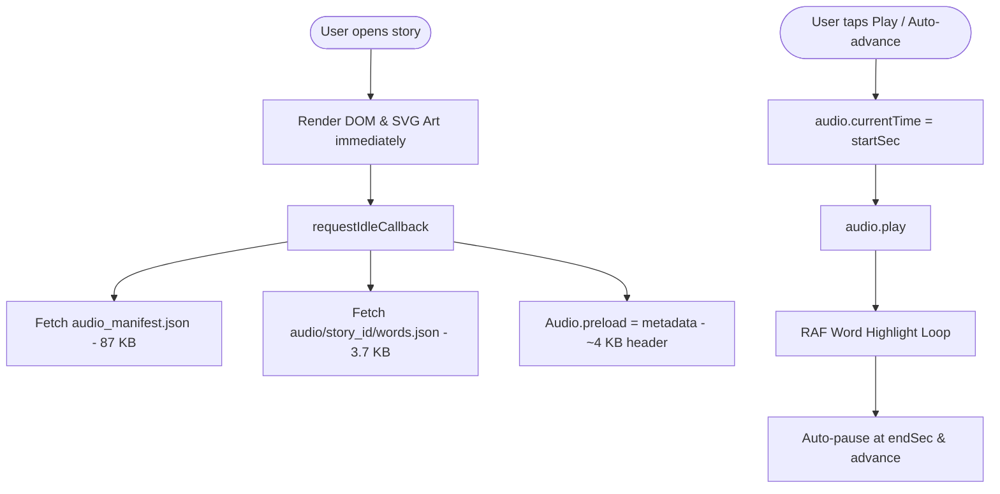

# Implementation Plan & System Architecture – Kids Storybook

**Project:** Magic Kids Storybook (Aesop's Fables for Children)  
**Location:** `plans/implementation_plan.md`  
**Hosting:** GitHub Pages Static Distribution (`src/ui/`) & Local Development Server (`scripts/serveUi.js`)  
**Status:** In Production / Feature Complete (152 Stories, Approach 2 Continuous Audio, Clean Path Routing, Sub-second Core Web Vitals)

---

## 1. Executive Summary & Vision

The **Magic Kids Storybook** is a rich, high-performance static web application delivering 152 classic Aesop fables adapted for young readers (ages 4–10). Each story features:
- **Sentence-by-sentence reading** with comic-style SVG panel animations.
- **Studio Neural Audio Narration** (Approach 2: Single Continuous Story Audio with millisecond timestamp cues) generated with Edge-TTS (`en-US-AnaNeural`).
- **Millisecond-exact word boundary karaoke synchronization** highlighting individual words as they are spoken.
- **Clean HTML5 History API Routing** (`/story/:storyId`), with seamless backwards-compatible migration for legacy hash routes (`/#story=:storyId`) and full SPA support on GitHub Pages (`404.html`).
- **Non-blocking asynchronous asset loading** using `requestIdleCallback`, ensuring First Contentful Paint (FCP) and Largest Contentful Paint (LCP) occur in under 800ms.
- **Zero-backend architecture**: 100% static client-side execution hosted on GitHub Pages with zero server dependencies or monthly operating costs.

---

## 2. Technical Stack & Architecture

| Layer | Technology | Key Details |
|---|---|---|
| **Frontend Framework** | Vanilla ES6+ SPA | Zero runtime dependencies; instantaneous boot & execution |
| **Vector Illustration** | Rough.js + Dynamic SVG Engine | Procedural hand-drawn comic panels (`svg-art.js`), dual rendering modes (Clean Vector vs Rough Sketch) |
| **Narration Engine** | Hybrid Studio Audio & Web Speech API | Dual-mode pipeline (`tts.js`): Edge-TTS Neural Audio with Web Speech API fallback |
| **Audio Format** | Continuous MP3 (128 kbps, 24 kHz) | Single continuous `story.mp3` per story with millisecond start/end sentence & moral cues |
| **Word Alignment** | Edge-TTS WordBoundary Timestamps | Extracted into lightweight per-story `words.json` (~3.7 KB) loaded lazily on demand |
| **State & Persistence**| LocalStorage & HTML5 History API | Persists playback rate, selected voice, favorites, and clean URL paths |
| **Distribution** | Static export from `src/ui/` | Automated build pipeline (`scripts/build_docs.py`) generating `sitemap.xml`, `robots.txt`, and `.nojekyll` |
| **Development Server** | Node.js Zero-Dependency Server | `scripts/serveUi.js` supporting HTTP 206 Range seeking and SPA rewrite rules |

---

## 3. High-Performance Audio Pipeline (Approach 2)

### 3.1 Single Continuous Audio vs Multiple Segment Files
Previously, synthesizing individual audio files for each sentence created ~1,200 separate MP3 files, resulting in browser connection queue limits, sentence-to-sentence audio jitter, and high HTTP overhead.

**Approach 2 Architecture:**
1. **Single Audio per Story:** Each story has one continuous `story.mp3` located at `audio/{story_id}/story.mp3`.
2. **Cue Ranges in Global Manifest (`data/audio_manifest.json`):**
   - The global manifest contains only story audio paths, durations, and sentence `[start, end]` ranges (87 KB unminified, ~15 KB gzipped).
   - This reduced the initial manifest payload by **96.8%** (down from 2.7 MB).
3. **On-Demand Word Manifest (`audio/{story_id}/words.json`):**
   - Millisecond-exact word boundaries (`{ "w": "word", "s": 0.10, "e": 0.35 }`) are isolated into per-story files (~3.7 KB).
   - Word boundaries are only fetched in the background when the user opens that specific story.
4. **Instant Zero-Latency Seeking & Playing:**
   - HTML5 `Audio` element seeks instantly to `startSec` and uses `requestAnimationFrame` tracking.
   - When playback reaches `endSec - 0.05`, playback pauses and triggers completion callbacks for seamless auto-advance.



---

## 4. Performance & Core Web Vitals Optimization

A critical performance objective was resolving mobile throttling bottlenecks where synchronous loading caused LCP to climb to 18.8s. The following measures reduced LCP to < 800ms:

1. **Unblocked Critical Path:**
   - `DOMContentLoaded` only waits for `stories.json`. `router()` executes immediately to paint the story catalog or comic panel.
   - `TTS.loadManifest()` runs entirely within `requestIdleCallback` (with 1.5s fallback).
2. **Metadata-Only Audio Preloading:**
   - `Audio.preload` is configured to `'metadata'` instead of `'auto'`. Only the initial ID3 header is loaded; full audio bytes are buffered only when playback is requested.
3. **In-Memory Audio Pool:**
   - Pre-instantiated `HTMLAudioElement` instances are cached in a Map pool. Rewinds, replays, and panel jumps experience 0ms fetch latency.
4. **HTTP 206 Partial Content Streaming:**
   - `scripts/serveUi.js` natively implements HTTP Range request handling, allowing iOS Safari and Android Chrome to scrub and seek through audio streams without re-downloading entire files.
5. **Zero Render-Blocking Requests:**
   - **Google Fonts (Est. savings ~830ms):** Converted to asynchronous non-blocking stylesheet loading with `<link rel="preload" as="style">` and `media="print" onload="this.media='all'"`.
   - **Deferred Client Scripts (Est. savings ~1,500ms):** Added `defer` to `rough.js`, `svg-art.js`, `tts.js`, and `main.js`, allowing HTML parsing and DOM construction to complete without pauses.
6. **Eliminated Critical Request Chaining:**
   - Added `<link rel="preload" href="data/stories.json" as="fetch" crossorigin>` in `<head>`. The browser downloads the 152-story database in parallel from the very first byte rather than waiting for `main.js` to parse and initiate the fetch.
7. **High-Performance Gzip Compression:**
   - Integrated native Node.js `zlib` stream compression into `scripts/serveUi.js`. Transferred payload sizes dropped by **75%–84%** (JSON: 241 KB -> 62 KB; JS: 43 KB -> 11 KB; CSS: 20 KB -> 4.6 KB).

---

## 5. Clean URL Routing & SPA Architecture

### 5.1 Route Mapping
| URL Pattern | View | Action |
|---|---|---|
| `/` or `/kids-stories/` | Library Catalog | Renders 152-story searchable and filterable grid |
| `/story/:story_id` | Story Reader | Renders sentence-by-sentence comic reader for `:story_id` |
| `/#story=:story_id` | Legacy Hash | Automatically upgraded to `/story/:story_id` via `history.replaceState` |

### 5.2 Dynamic Base & GitHub Pages Support
- **Dynamic `<base>` Tag:**
  When accessing deep paths like `/story/crow_and_water_pot` on localhost or `/kids-stories/story/crow_and_water_pot` on GitHub Pages, an inline `<script>` in `<head>` calculates the repository base path and injects `<base href="...">`. This guarantees all relative asset URLs (`style.css`, `main.js`, `tts.js`, `data/stories.json`, `audio/...`) resolve accurately.
- **GitHub Pages SPA Fallback (`src/ui/404.html`):**
  Direct visits or page reloads on static hosts are intercepted by `404.html`, which encodes the requested pathname into a query redirect string (`/?/story/crow_and_water_pot`) and loads `index.html`. `index.html` restores the clean path with `history.replaceState` with 0ms visual flash.
- **Local Dev Server Rewrite:**
  `scripts/serveUi.js` transparently rewrites `/story/*` requests without extensions to `index.html`, matching production server behavior.

---

## 6. Directory Structure

```
kids_storybook_plan/
├── plans/                        # Project architectural & enhancement plans
│   ├── implementation_plan.md    # Master system architecture & roadmap (this document)
│   ├── svg_enhancement_plan.md   # Scene layout & multi-character illustration plan
│   └── audio_streaming_optimization_plan.md # Continuous audio & karaoke seeking plan
├── scripts/
│   ├── build.py                  # Static build & SEO generator
│   ├── build_docs.py             # Compatibility build script
│   ├── generate_audio.py         # Multi-worker Edge-TTS generator (Approach 2)
│   └── serveUi.js                # Zero-dependency local dev server with Range & SPA support
├── src/
│   ├── data/                     # Source datasets & test suites
│   │   ├── stories.json          # Master 152 curated fables with metadata
│   │   ├── audio_manifest.json   # Master lightweight cue manifest
│   │   └── test_stories.py       # Pytest schema and story validation suite
│   └── ui/                       # Single canonical Web Application & GitHub Pages deploy directory
│       ├── .nojekyll             # Bypasses Jekyll processing
│       ├── 404.html              # SPA redirect for direct URLs
│       ├── index.html            # Application shell with dynamic base script
│       ├── main.js               # Application controller & history router
│       ├── tts.js                # Dual-mode speech & timestamp cue player
│       ├── svg-art.js            # Hand-drawn Rough.js comic art generator
│       ├── rough.js              # Rough.js vector graphics library
│       ├── style.css             # Responsive kid-friendly styles
│       ├── sitemap.xml           # SEO sitemap with /story/:id clean URLs
│       ├── robots.txt            # Search engine crawler permissions
│       ├── data/
│       │   ├── stories.json      # 152 curated fables with metadata
│       │   └── audio_manifest.json # 87 KB lightweight cue manifest
│       └── audio/
│           └── [story_id]/
│               ├── story.mp3     # Continuous story narration audio
│               └── words.json    # Millisecond-exact word boundary timestamps
└── .github/
    └── workflows/
        └── deploy.yml            # Automated GitHub Pages CI/CD workflow (deploys src/ui/)
```

---

## 7. Verification & Testing Protocol

To ensure system integrity, execute the following verification steps:
1. **Python Dataset Tests:**
   ```bash
   python3 -m pytest src/data/test_stories.py -v
   ```
2. **JavaScript Syntax Verification:**
   ```bash
   node -c src/ui/main.js && node -c src/ui/tts.js && node -c scripts/serveUi.js
   ```
3. **Build & Distribution Verification:**
   ```bash
   python3 scripts/build_docs.py
   node -c src/ui/main.js && node -c src/ui/tts.js
   ```
4. **Local Server Route Verification:**
   ```bash
   curl -I http://localhost:8080/story/crow_and_water_pot
   curl -I http://localhost:8080/data/stories.json
   curl -r 0-100 -I http://localhost:8080/audio/crow_and_water_pot/story.mp3
   ```

---

## 8. Future Roadmap

1. **Cloudflare R2 / Custom CDN Audio Serving:**
   - Configure `cdn_base_url` in `audio_manifest.json` to stream MP3 files from Cloudflare R2 or custom CDN storage, offloading repository clone size while retaining 100% static hosting.
2. **Multi-Character Vector Layouts:**
   - Implement Phase 2 of `plans/svg_enhancement_plan.md`, rendering opposing characters facing each other during dialogue sentences with contextual props.
3. **PWA / Service Worker Offline Cache:**
   - Introduce a lightweight Service Worker caching visited stories and audio files for offline playback in cars, airplanes, and classrooms.
