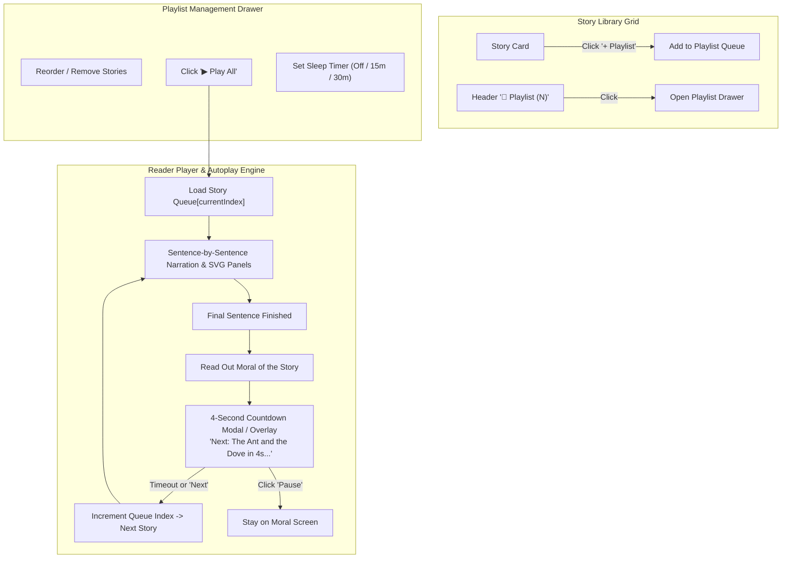

# TalePickle Story Playlist & Continuous Autoplay — Feature Design Specification

## 1. Executive Summary
The **Story Playlist & Continuous Autoplay** feature enables parents and children to curate a sequence of illustrated Aesop's fables and listen to them hands-free back-to-back. When one story finishes, TalePickle naturally reads the moral, displays a brief celebratory transition countdown, and seamlessly starts narrating the next story in the playlist with synchronized watercolor storyboard panels and audio narration.

---

## 2. Key Use Cases

| Persona | Use Case | Desired Experience |
| :--- | :--- | :--- |
| **Parents at Bedtime** | "Wind-Down Bedtime Queue" | Queue 3-5 gentle stories, tap "Play All", place the phone/tablet on the nightstand. Stories play continuously without parent needing to tap every 2 minutes. |
| **Early Learners & Kids** | "Favorite Animals Playlist" | Kids click `+ Playlist` on stories about lions, foxes, and mice to create their own adventure marathon. |
| **Classrooms & Car Rides** | "Hands-Free Listening" | Teachers or drivers start a 20-minute playlist of moral fables for continuous listening without screen interaction. |

---

## 3. System Architecture & Flow



---

## 4. UI/UX Component Specifications

### 4.1. Library Card "+ Playlist" Action
- **Placement:** Top-left or action bar of each story card in the library grid.
- **States:**
  - *Default:* Small translucent badge `➕ Playlist`.
  - *Added:* Highlighting badge `🎵 In Playlist (#2)` with checkmark. Clicking toggles removal or opens playlist.
- **Animation:** Micro-bounce feedback on add with toast notification: *"Added 'The Wolf and the Lamb' to Playlist (3 stories)"*.

### 4.2. Header Playlist Pill
- **Placement:** Main navigation header alongside "🎲 Surprise Me!" and "❤️ Favorites".
- **Visuals:** Purple/Indigo gradient badge: `🎵 Playlist (3)`.
- **Badge:** Counter badge showing the number of queued stories.

### 4.3. Slide-Over Playlist Drawer / Modal
When clicking `🎵 Playlist`, a modern slide-over drawer opens from the right (or bottom sheet on mobile):
- **Header:**
  - Title: *"Your Story Playlist"*
  - Total duration estimate (e.g. *"4 stories • ~14 mins"*).
  - Close button (`✕`).
- **Body:**
  - Draggable / reorderable list of story items.
  - Each item displays:
    - Small square cover thumbnail (`data/story_images/{id}.svg`).
    - Story title, animal badge, and sentence count.
    - Up / Down reorder arrows (`⬆️`, `⬇️`).
    - Delete button (`🗑️`).
- **Footer Controls:**
  - **Primary CTA:** Large `▶️ Play Playlist` button (starts from story 1 or current story).
  - **Secondary CTA:** `🔀 Shuffle Queue`.
  - **Sleep Timer Pill:** `🌙 Bedtime Timer: Off ▾` (options: `Off`, `15 min`, `30 min`, `End of Playlist`).
  - **Clear:** `Clear All`.

### 4.4. Reader Playlist Banner & Autoplay Mini-Bar
When reading a story that was launched from a playlist:
- **Top Sticky Banner:**
  - `🎵 Playlist: 2 of 4 • Up Next: "The Tortoise and the Hare" [Skip ⏭️] [View Queue ☰]`
- **Moral Screen Auto-Advance Countdown:**
  - After moral is spoken by TTS, a celebratory progress bar appears:
    - *"Up Next in 5s: The Tortoise and the Hare"*
    - Animated progress bar that fills over 4-5 seconds.
    - Buttons: `[Play Now ⏭️]` and `[Cancel Auto-Advance ⏸️]`.
    - When time expires, smoothly transitions to `/story/{nextId}` with narration starting automatically.

---

## 5. Data Model & State Persistence

Stored in `localStorage` under key `talepickle_playlist_v1`:

```typescript
interface StoryPlaylistState {
  version: 1;
  items: string[];            // Array of story IDs in play order, e.g. ["the_lion_and_the_mouse", "fox_and_grapes"]
  currentIndex: number;       // Active story index in the playlist
  isPlaylistMode: boolean;    // Whether reader was opened in continuous playlist mode
  autoAdvanceSeconds: number; // Delay between stories on moral screen (default: 4s)
  isLooping: boolean;         // Whether to repeat playlist from start when finished
  sleepTimerEnd: number | null; // Timestamp (ms) when audio should automatically fade/stop
}
```

---

## 6. Implementation Plan

1. **Phase 1: Playlist State Management (`playlist.js` / module in `main.js`)**
   - Implement `PlaylistManager` with methods: `add()`, `remove()`, `reorder()`, `clear()`, `shuffle()`, `setSleepTimer()`, and `getState()`.
   - Auto-save to `localStorage`.
2. **Phase 2: Library UI Enhancements**
   - Add `+ Playlist` buttons to `.story-card` in `renderList()`.
   - Add `🎵 Playlist (N)` button in the top navigation bar.
   - Build slide-over playlist drawer with live item count and duration estimate.
3. **Phase 3: Reader Integration & Autoplay Transition**
   - Add playlist header badge in reader mode.
   - Implement moral countdown banner with cancel and skip buttons.
   - Hook into `TTS.speakMoral()` completion callback to trigger countdown and seamless navigation.
4. **Phase 4: Bedtime Timer & Polish**
   - Add optional 15/30-minute sleep timer that gracefully stops TTS when time expires.
   - Verify keyboard navigation (`P` to open playlist, `N` to skip to next playlist item).
